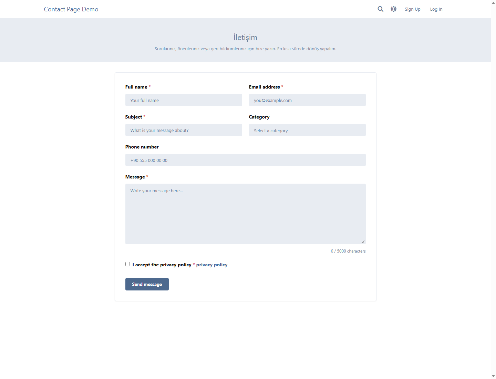
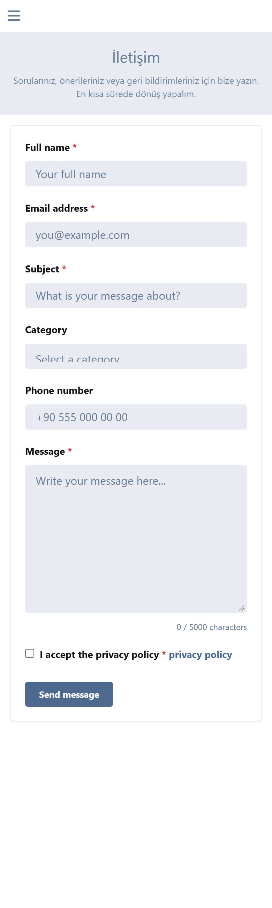
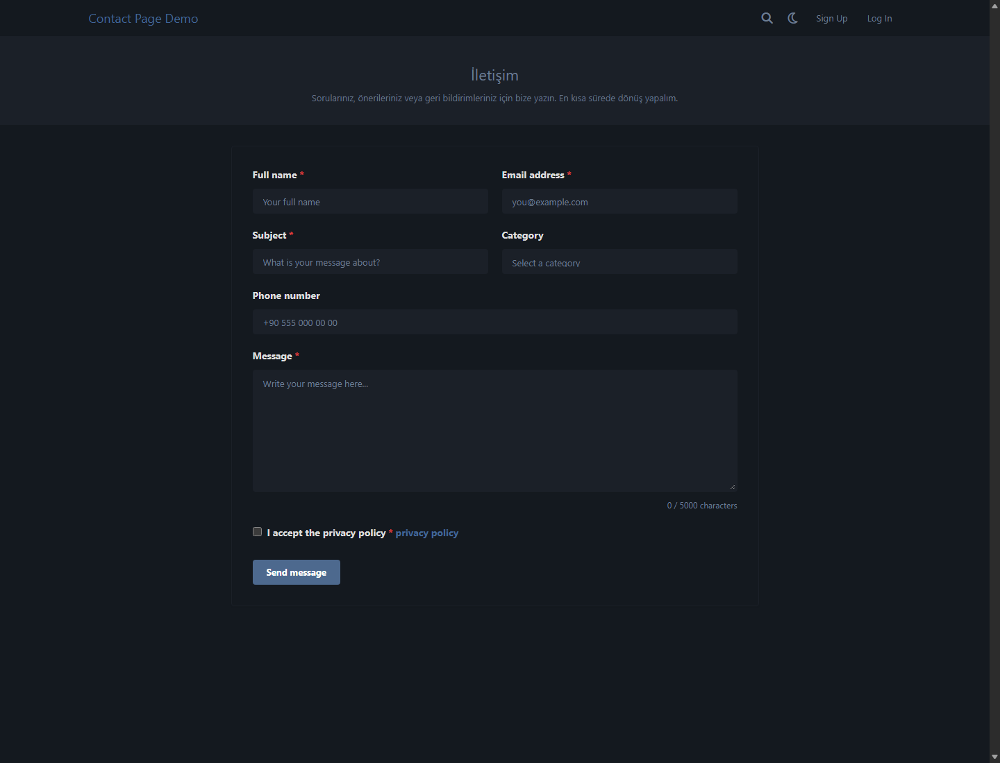
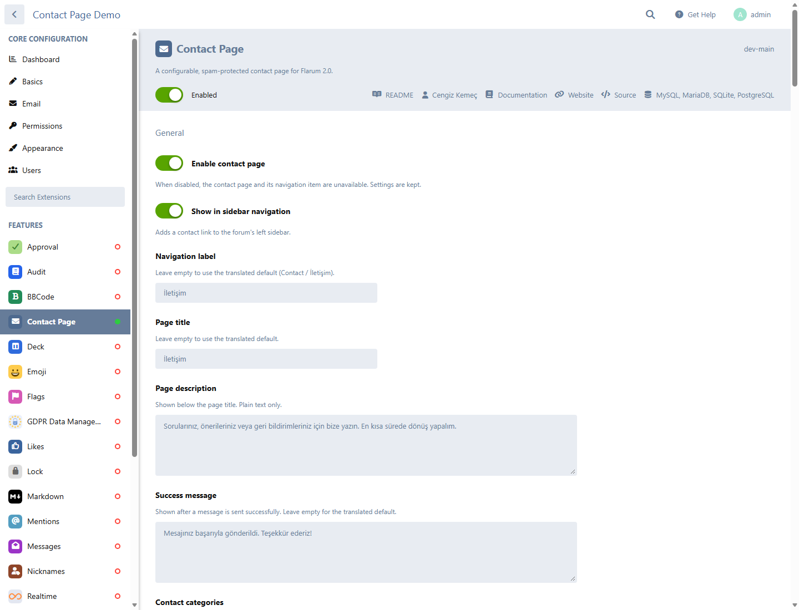

# Contact Page for Flarum 2.0

[](https://github.com/cengizkemec/flarum-contact-page/actions/workflows/backend.yml)
[](https://github.com/cengizkemec/flarum-contact-page/actions/workflows/frontend.yml)
[](LICENSE)
[](https://flarum.org)
[](https://www.php.net)

A configurable, production-oriented contact page for Flarum 2.0. It adds a
native `/contact` page, a configurable sidebar link, a dynamic contact form,
and layered spam protection — without adding another SMTP configuration layer.

Turkish documentation: [README.tr.md](README.tr.md)

## Features

- Dedicated `/contact` page with native Flarum styling and responsive layout.
- Sidebar navigation entry, shown only when the page is available to the visitor.
- Configurable fields: full name, email, subject, message, category, phone and
  privacy acceptance. Every field can be enabled, disabled, required or optional.
- Four access modes: everyone, registered users only, guests only, disabled.
- Additional guest/member switches and optional verified-email requirement.
- Optional prefill of name and email for logged-in users.
- Contact categories managed by line-separated labels.
- Configurable minimum/maximum message length and subject length.
- Sends through Flarum's configured mailer. No separate SMTP settings.
- HTML and plain-text email versions.
- Safe sender address from Flarum's `mail_from`; visitor email is used as
  `Reply-To` only after strict validation and when enabled.
- Optional Cloudflare Turnstile, verified server-side against Siteverify with
  hostname, action, freshness and replay checks.
- Layered abuse protection: honeypot, time trap, cooldown, per-IP rate limit,
  duplicate detection, request-size limit and all standard Flarum CSRF checks.
- Privacy-conscious rate limiting: IP addresses and duplicate fingerprints are
  HMAC-hashed with a per-installation salt and stored only as short-lived cache keys.
- Server-side settings validation and a whitelisted public configuration payload.
- Complete English and Turkish translations.
- No migrations, no core file modifications and no permanent message storage.

## Requirements

| Component | Supported |
| --- | --- |
| Flarum | 2.0.0 or newer |
| PHP | 8.3 or newer |
| Database | MySQL 8+, MariaDB 10.6+, PostgreSQL 10+, SQLite 3.35+ |
| Mail | Any mail driver configured in Flarum that can actually deliver mail |

The test suite in this repository was executed against Flarum **2.0.2** on
PHP **8.4.27** with SQLite. Flarum's own package constraint requires PHP
`^8.3`; the GitHub Actions matrix covers PHP 8.3 and 8.4.

## Installation

```bash
composer require cengizkemec/flarum-contact-page
```

The package is published on
[Packagist](https://packagist.org/packages/cengizkemec/flarum-contact-page).
Composer resolves the latest tagged release automatically.

Then:

1. Open **Administration → Extensions**.
2. Enable **Contact Page**.
3. Open the extension settings page.
4. Under **General**, enable the contact page and configure the page title,
   categories and navigation settings.
5. Under **Email**, set the recipient email address and verify that Flarum's
   global mail settings are configured and working.
6. Optionally enable Cloudflare Turnstile under **Security**.
7. Clear the Flarum cache if your setup requires it:

```bash
php flarum cache:clear
```

The page is available at `/contact`.

## Configuration

The extension settings are grouped into General, Access permissions, Form
configuration, Message limits, Email, Security, Cloudflare Turnstile, Rate
limiting and Localization. A detailed reference is available in
[docs/configuration.md](docs/configuration.md).

### Recipient email

The recipient is configured under **Contact Page → Email → Recipient email
address**. It must be a valid, routable address. The extension never accepts a
recipient from the visitor.

### Email delivery

The extension uses Flarum's existing mail transport and the global `mail_from`
address. It does not add a second SMTP configuration system.

- Both HTML and plain-text views are supplied. Flarum's `mail_format` setting
  decides whether the message is sent as multipart, HTML-only or plain-text.
- The visitor's email is used as `Reply-To` only when it passed validation and
  the option is enabled.
- If the configured driver cannot send mail, or the transport throws an error,
  the visitor sees a failure message and no success state. The form fails
  closed instead of pretending the message was delivered.
- Log and Null drivers do not deliver real mail; the extension treats them as
  unavailable.

### Cloudflare Turnstile

Turnstile is optional but **strongly recommended for public guest forms**.

1. Create a Turnstile widget in the Cloudflare dashboard.
2. Add the domain that serves your forum.
3. Copy the site key and secret key into **Contact Page → Security → Turnstile**.
4. Enable Turnstile and save.
5. Confirm the expected hostname if your forum is behind a proxy that changes
   the request host.

The secret key is never serialized to the forum frontend and is never written to
logs. Tokens are sent to Cloudflare's official Siteverify endpoint over HTTPS,
checked for the `contact` action and expected hostname, checked for freshness,
and remembered as a hash to reject replays.

### Access modes

| Mode | Guests | Registered users |
| --- | --- | --- |
| Everyone | Allowed | Allowed |
| Registered users only | Denied | Allowed |
| Guests only | Allowed | Denied |
| Disabled | Denied | Denied |

The two additional switches can narrow access further. All checks are enforced
on the server; hiding the sidebar item is only a convenience.

## Screenshots

| Desktop, light | Mobile |
| --- | --- |
|  |  |

| Desktop, dark | Administration |
| --- | --- |
|  |  |

The screenshots were captured from a real Flarum 2.0.2 installation running this
extension. See [docs/screenshots](docs/screenshots/README.md).

## Security

Security details and the threat model are documented in
[docs/security.md](docs/security.md). The short version:

- Every submission is authorized and validated on the server.
- Flarum's normal CSRF protection stays enabled for the API endpoint.
- Turnstile verification is server-side, fail-closed and replay-protected.
- Email addresses are parsed with Symfony Mime; CR/LF header injection and
  display-name smuggling are rejected.
- Rate-limit and duplicate keys contain HMACs only. Raw IP addresses are not
  stored permanently.
- The Turnstile secret, recipient address, rate-limit configuration and
  security salt are never exposed through the public forum payload.
- No message content, visitor name, visitor email or raw IP is written to logs.
- Turnstile is optional, but public guest forms should enable it.

To report a vulnerability, please follow [SECURITY.md](SECURITY.md).

## Development

```bash
composer install
composer test:setup   # creates the SQLite test installation
composer test         # unit + integration tests
composer analyse      # PHPStan level 8
composer validate --strict
```

Frontend:

```bash
cd js
npm ci
npm run check-typings
npm run build
npm run format-check
```

Integration tests use Flarum's testing package with SQLite by default. The
database and temporary Flarum installation are created under
`vendor/flarum/testing/src/integration/tmp` unless `FLARUM_TEST_TMP_DIR_LOCAL`
is set.

## Localization

The extension ships with `locale/en.yml` and `locale/tr.yml`. The active Flarum
language is used for all user-facing strings; the configured default language is
used as a fallback for email messages when the current language is neither
English nor Turkish. Translation keys are covered by an automated parity test.

## Compatibility notes

- Flarum 2.0 changed the extension/admin/JSON:API architecture significantly;
  this extension targets those APIs, not Flarum 1.x patterns.
- Flarum 2.0 supports SQLite and PostgreSQL. This extension has no database
  tables or database-specific queries.
- The extension requires a working Flarum mail configuration. It intentionally
  does not bypass Flarum's mail layer.

## License

MIT © Cengiz Kemeç
